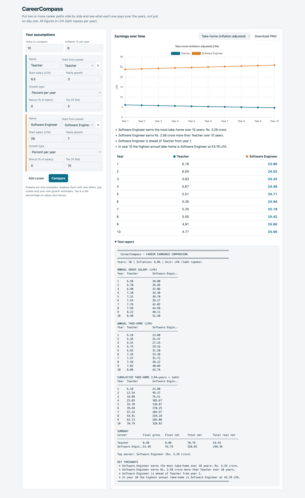

# CareerCompass

**Compare careers by what you actually earn over the years, not just the starting salary.**

CareerCompass is a Spring Boot application that projects salary and cumulative earnings for two or more career paths side by side. It gives you a text report, an interactive chart, and a downloadable PNG, so you can see which path pays more, by how much, and from which year.

All amounts are in **LPA** (lakh rupees per year). One LPA earned for one year equals one lakh rupees, so "LPA-years" and "lakh" are the same unit.

---

## Features

- Compare **2 to 8 careers** over **1 to 40 years**
- Fully customisable inputs for each career:
  - starting salary
  - yearly growth, either a **percentage** (compounding) or a **fixed LPA amount**
  - yearly bonus as a % of salary
  - flat tax %
- Global inflation % to see inflation-adjusted take-home
- **Three outputs** from the same calculation:
  - JSON API
  - plain-text report (tables, summary, takeaways)
  - PNG chart rendered on the server with JFreeChart
- Interactive browser UI with a Chart.js line chart, a comparison table, and a switchable metric
- Plain-language insights, for example *"X overtakes Y in cumulative earnings from year 6"*
- Ready-made presets (Teacher, Software Engineer, Government Officer, Bank Officer, Doctor, Custom)
- Console report at startup, like the original command-line program
- No database. Everything is calculated in memory per request

---

## Tech stack

| Area | Choice |
|---|---|
| Language | Java 25 |
| Framework | Spring Boot 4.1.2 (Web, Validation, actuator, swagger-ui) |
| Server-side charts | JFreeChart 1.5.6 |
| Browser charts | Chart.js 4.4.1 (loaded from CDN) |
| Build tool | Maven |

---

## Getting started

### Prerequisites

- JDK 25 or newer
- Maven 3.9 or newer
- Internet access the first time, to download dependencies. The web page also loads Chart.js from a CDN

### Run

```bash
mvn spring-boot:run
```

Then open **http://localhost:8080**.

To build a runnable jar instead:

```bash
mvn clean package
java -jar target/career-compass-1.0.0.jar
```

### Configuration

`src/main/resources/application.yml`

```yaml
server:
  port: 8080

careercompass:
  console-report: true   # print a Teacher vs Software report at startup
```

---

## How the numbers are calculated

For each career and each year:

1. **Gross salary**
   - Year 1 is the starting salary.
   - Later years use either `previous * (1 + growth / 100)` (percent) or `previous + growth` (fixed LPA).
2. **Bonus** = gross * bonus %
3. **Tax** = (gross + bonus) * tax %
4. **Take-home (net)** = gross + bonus - tax
5. **Inflation-adjusted take-home** = net / (1 + inflation / 100) ^ (year - 1)
6. **Cumulative values** are running totals of gross and net

Tax is a simple flat percentage, not a slab-based tax calculator. Treat the results as estimates for comparison, not financial advice.

---

## Using the web UI

1. Set the number of years and the inflation rate.
2. For each career, pick a preset or type your own name and numbers.
3. Use **Add career** to compare more paths, or the **x** button to remove one.
4. Click **Compare**.
5. Switch the metric (annual gross, annual take-home, inflation-adjusted, cumulative) from the dropdown.
6. Click **Download PNG** to save the server-rendered chart.
7. Expand **Text report** to copy the plain-text version.

---

## API

Base path: `/api`

| Method | Path | Description |
|---|---|---|
| GET | `/api/meta` | Presets, chart metrics and growth models used by the UI |
| POST | `/api/compare` | Full comparison as JSON |
| POST | `/api/compare/text` | Comparison as a plain-text report |
| POST | `/api/compare/chart.png?metric=CUMULATIVE_NET` | Comparison as a PNG chart |

### Request body

```json
{
  "years": 10,
  "inflationPercent": 5,
  "careers": [
    {
      "name": "Teacher",
      "startSalaryLpa": 6.5,
      "annualGrowth": 3,
      "growthModel": "COMPOUND_PERCENT",
      "bonusPercent": 0,
      "taxPercent": 0
    },
    {
      "name": "Software Engineer",
      "startSalaryLpa": 25,
      "annualGrowth": 7,
      "growthModel": "COMPOUND_PERCENT",
      "bonusPercent": 0,
      "taxPercent": 0
    }
  ]
}
```

| Field | Notes |
|---|---|
| `years` | 1 to 40. Defaults to 10 |
| `inflationPercent` | 0 or more. Defaults to 0 |
| `careers` | 2 to 8 items |
| `growthModel` | `COMPOUND_PERCENT` or `FIXED_AMOUNT_LPA`. Defaults to `COMPOUND_PERCENT` |
| `annualGrowth` | A percentage or an LPA amount, depending on `growthModel` |
| `taxPercent` | 0 to 100 |

### Chart metrics

`ANNUAL_GROSS`, `ANNUAL_NET`, `REAL_NET`, `CUMULATIVE_NET` (default), `CUMULATIVE_GROSS`

### Example with curl

```bash
curl -X POST http://localhost:8080/api/compare/text \
  -H "Content-Type: application/json" \
  -d @request.json

curl -X POST "http://localhost:8080/api/compare/chart.png?metric=ANNUAL_NET" \
  -H "Content-Type: application/json" \
  -d @request.json --output chart.png
```

### Validation errors

Invalid input returns HTTP 400:

```json
{ "errors": ["careers: Compare between 2 and 8 careers"] }
```

---

## Project structure

```
career-compass
├── pom.xml
├── docs/images/                    # screenshots used in this README
└── src/main
    ├── java/com/achhecode/careercompass
    │   ├── CareerCompassApplication.java
    │   ├── constant/               # AppConstants, ApiPaths
    │   ├── enums/                  # GrowthModel, ChartMetric, CareerPreset
    │   ├── dto/                    # CareerInput, ComparisonRequest, PresetDto
    │   ├── model/                  # YearlyRecord, CareerResult, ComparisonResult
    │   ├── service/                # projection, insights, text report, chart image, presets
    │   ├── controller/             # ComparisonApiController
    │   ├── exception/              # GlobalExceptionHandler
    │   ├── runner/                 # ConsoleReportRunner
    │   └── util/                   # MoneyUtil
    └── resources
        ├── application.yml
        └── static/index.html       # browser UI
```

### How a request flows

```
Browser / client
      |
ComparisonApiController
      |
ComparisonService --> SalaryProjectionService (one projection per career)
      |           --> InsightService (winner, gaps, crossover year)
      |
TextReportService / ChartImageService / JSON
```

---

## Customising

- **Add a preset:** add a line to the `CareerPreset` enum. It appears in the UI automatically.
- **Add a chart metric:** add a value to `ChartMetric` and a matching field to `YearlyRecord`.
- **Change limits** (years, number of careers, chart size): edit `AppConstants`.
- **Add a growth model:** add a value to `GrowthModel` and handle it in `SalaryProjectionService.nextSalary`.

The preset numbers are only illustrative. Replace them with real offers, pay scales and your own growth estimates.

---

## Limitations

- Tax is a flat percentage and ignores slabs, deductions and regime differences.
- Growth is assumed constant. Promotions, job switches and career breaks are not modelled yet.
- Nothing is saved. Refreshing the page resets the inputs.
- The web page needs internet access to load Chart.js.

## Ideas for next steps

- Save and share a comparison through a link
- Job-switch or promotion hikes in specific years
- Starting at different ages, or a gap for further study
- Slab-based income tax
- Export to Excel or PDF
- Investment growth on savings

---

## Screenshots

Add your screenshots to `docs/images/` using the file names below, and they will show up here.

### Comparison dashboard
